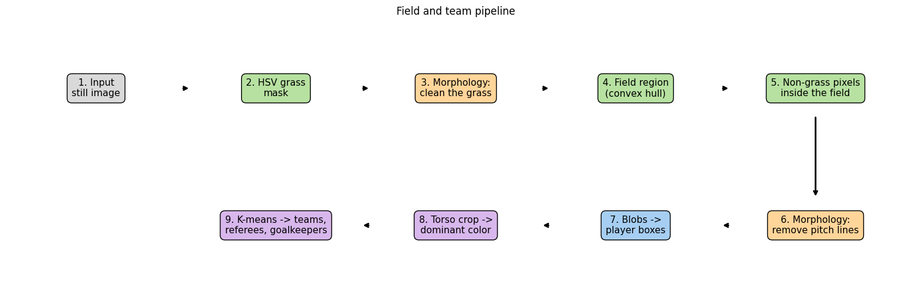
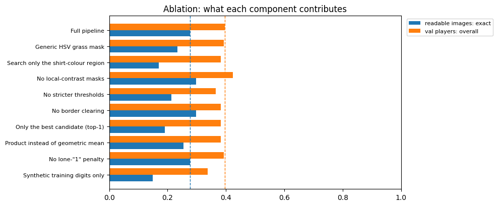

# Seeing the Game: Soccer Player Identification from Still Images

**CSC 481 – Introduction to Image Processing · Muzammil Ali Khan & Sidra Azeem**

Given one still frame from a soccer broadcast, we find every person on the pitch, group them into the two teams, goalkeepers and referees, and read each player's jersey number, or answer **"unreadable"** when the number can't be seen.

Everything is built with classical image processing (color spaces, thresholding, morphology, connected components, clustering). The only learned parts are small classifiers **trained from scratch: no pretrained models** are used anywhere.



## Pipeline

**Field and teams** (`notebooks/01_field_and_teams.ipynb`)

1. **Grass mask:** HSV threshold (hue 35–85), so grass keeps the same hue in sun and shade.
2. **Field region:** opening removes specks, closing rejoins grass cut by pitch lines, and the convex hull gives the field.
3. **Players:** non-grass pixels inside the field, with an opening that removes thin pitch lines.
4. **Player boxes:** connected components filtered by size and shape.
5. **Team colors:** dominant (most common quantized) color of each torso, grouped with K-means (K = 2 for teams, K = 5 to also separate referees and goalkeepers).

**Jersey numbers** (`notebooks/02_jersey_numbers.ipynb`)

1. **Usable images:** torso crop, bicubic upscaling, size and sharpness checks.
2. **Shirt color:** K-means in LAB color space, then a contrast map (ΔE) against the shirt inside the player's silhouette.
3. **Number mask:** Otsu thresholding at several scales, opening and closing, border clearing.
4. **Digits:** connected components with shape rules; touching digits are cut at the thinnest column.
5. **Reading:** three classifiers compared, simplest first: shape features (holes, Hu moments, zoning) with kNN/SVM, HOG + SVM, and a small CNN trained from scratch on synthetic and real digits.
6. **Decision:** below a confidence threshold τ the answer is "unreadable"; the six frames of a player vote.


## Data

Both halves use [SoccerNet](https://www.soccer-net.org/), a public benchmark of professional broadcasts with human labels.

| Task | What we use | Size |
| --- | --- | --- |
| Game State Reconstruction | Full frames, every person boxed with role and team | 60 frames from 6 clips · 802 players, 39 goalkeepers, 75 referees |
| Jersey Number Recognition | Close-up crops of one player per clip | 1,427 train / 1,211 test players, 6 frames each · 28% show no number |

Labels are only used to measure results and to train the digit classifiers. Data is not included in this repository; the notebooks download it.

## Results (preliminary)

**Field and teams** (60 frames)

| Detection recall | Detection precision | Team accuracy (K = 2) | Purity (K = 5) |
| --- | --- | --- | --- |
| 0.68 | 0.83 | 0.92 | 0.90 |

Players shorter than 40 px are almost never found (recall 0.00, vs 0.70 above 80 px).

**Jersey numbers** (1,211 test players; τ chosen on validation, test scored once)

| Method | Player accuracy |
| --- | --- |
| Always "unreadable" (baseline) | 0.29 |
| Shape features + kNN | 0.29 |
| HOG + SVM | 0.36 |
| Small CNN (from scratch) | 0.40 |
| **CNN + visibility filter** | **0.42** |
| End-to-end CNN (from scratch) | 0.40 (0.68 on validation) |

When the reader is confident (τ = 0.8), 67% of its answers are correct, and 93% of players without a visible number are correctly called "unreadable".



## Main sources of error

Strong shadows outside the grass hue range, overlapping and very small players, pale numbers on white kits, and blur that fuses two digits into one blob. Deblurring and other clean-up steps did not recover these: the detail is missing from the image.

## Improvements after the progress presentation

The "next steps" from our presentation are now in the notebooks. Each is a switch with a before/after comparison, chosen on validation data:

| Improvement | Where | Idea |
| --- | --- | --- |
| Shadow-robust grass mask | 01, Part 8A | K-means (K = 2) learns this frame's sunlit and shaded grass colors; a pixel is grass if it is close to either in LAB, with lightness weighted 0.5 |
| Split touching players | 01, Part 8B | Wide, solid blobs are cut at the valleys of their column sums (projection profile) |
| Fairer detection score | 01, Part 8C | One-to-one matching, so one box over two players no longer counts as finding both |
| LAB team colors | 01, Part 8D | Shirt colors clustered in LAB (optionally with lightness weighted down) |
| Split touching digits | 02, B5 | Erosion finds one seed per digit, watershed grows them back to full stroke thickness |
| More real training digits | 02, B6 | Harvest from 24 instead of 6 frames per labelled player, augmentation, test on held-out players |
| Both halves together | 00, Part III | The detector's boxes are read by the jersey reader on the same GSR frames |

Results of these sections will be added after the next full run in Colab.

## Repository layout

```
notebooks/
  00_full_pipeline.ipynb          both halves in one notebook: Part I (01), Part II (02), Part III (both together)
  01_field_and_teams.ipynb        field, players and teams, improvements in Part 8 (Muzammil)
  02_jersey_numbers.ipynb         jersey-number pipeline, experiments A1–A4, B1–B6 (Sidra)
  03_jersey_end_to_end_cnn.ipynb  end-to-end CNN trained from scratch (Sidra; outputs not saved)
figures/                          key figures exported from the notebooks
```

## Running

The notebooks were written for Google Colab (a GPU helps only for the CNN). Open `00_full_pipeline.ipynb` in Colab and Run all; the jersey part mounts Google Drive and keeps its data and saved results in `MyDrive/csc481_soccer` (set `DOWNLOAD_DATA = True` the first time). Notebooks 01 and 02 still run on their own. Local use: `pip install -r requirements.txt`.

## License

[MIT](LICENSE)
